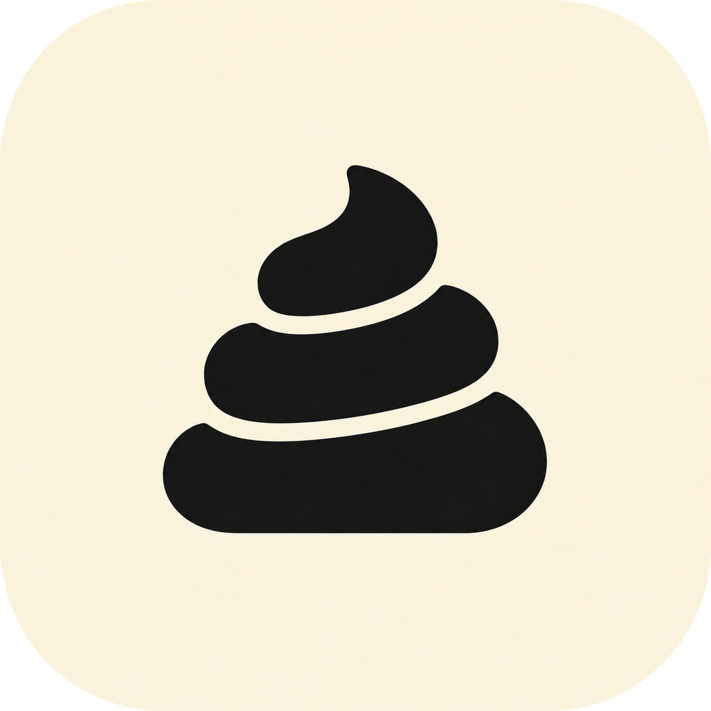
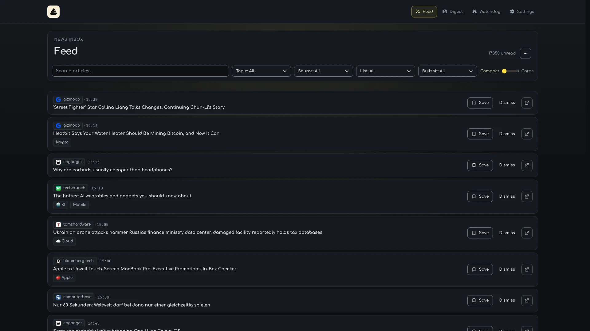
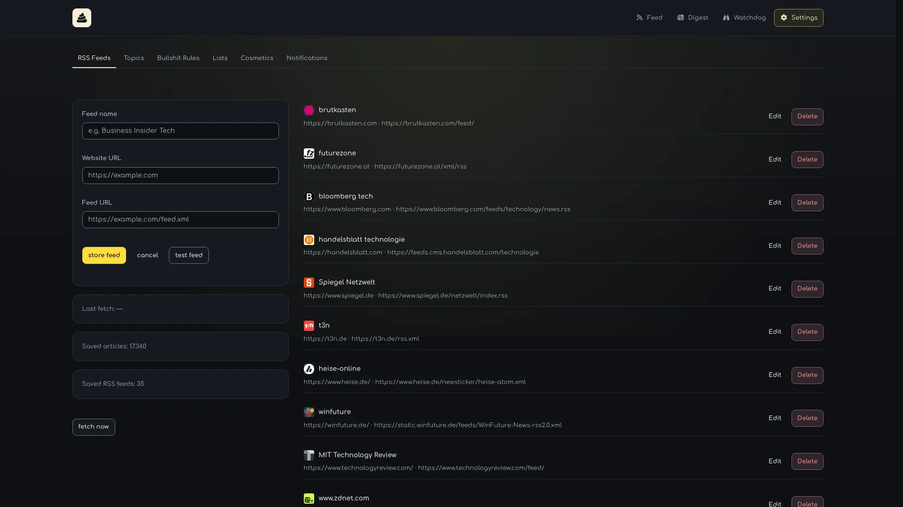
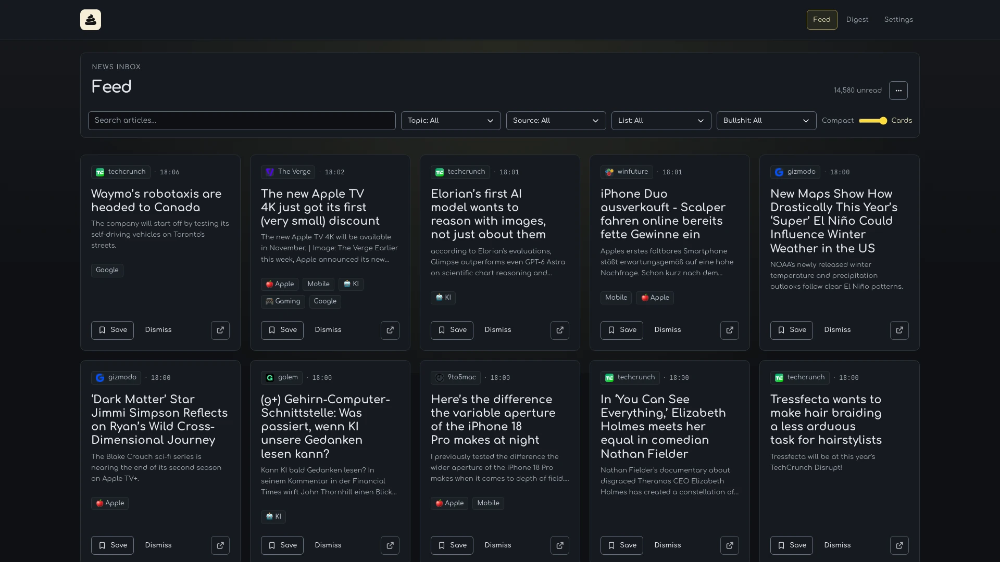
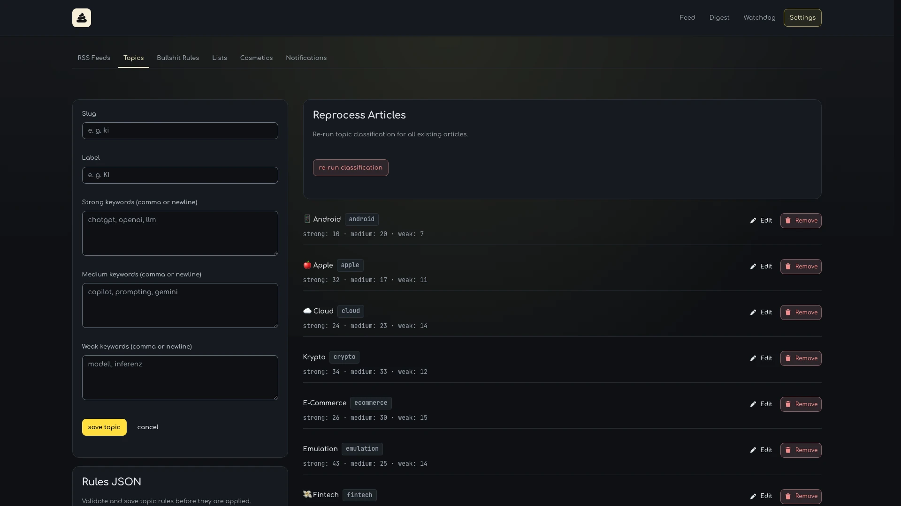
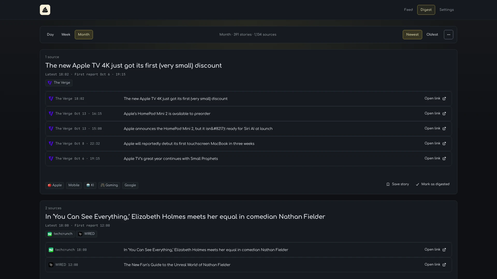
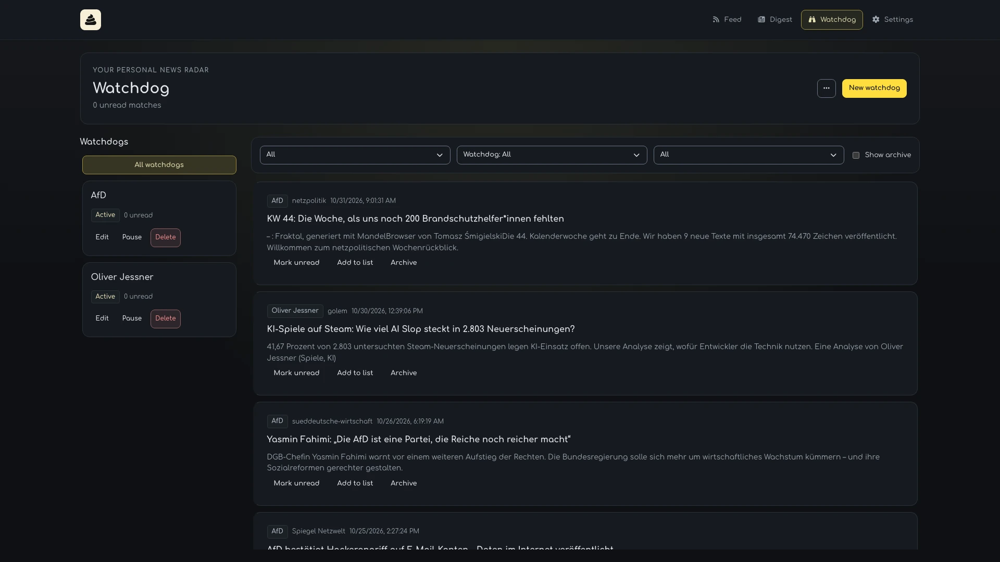

<p align="center">
  
</p>

# NO BULLSHIT RSS 💩

[](https://github.com/oliverjessner/NO-BULLSHIT-RSS/actions/workflows/dependabot/dependabot-updates)

NO BULLSHIT RSS is a free, open-source desktop RSS reader for macOS.
It brings your sources together and helps you find relevant stories in a busy news feed.
Your feeds, saved articles and reading lists stay on your Mac, without subscriptions or ads.



Add your RSS feeds in Settings, then browse new articles or catch up through a daily, weekly or monthly digest.
Save useful articles to reading lists and create keyword alerts for subjects you follow closely.

## What it does

- Follow RSS feeds in compact or card layouts.
- Search articles and filter by source, topic or reading list.
- Group related coverage into daily, weekly and monthly digests.
- Explore publisher rankings in Most read, mixing all supported media or choosing Golem, WinFuture, ComputerBase, heise iX, t3n, TechCrunch or Ars Technica.
- Automatically tag articles with your own topic keywords and filter unwanted coverage with bullshit rules.
- Track keyword matches in Watchdog, with optional macOS notifications.
- Save articles to reading lists and dismiss finished articles or stories.
- Import article links and export results as Markdown, JSON, CSV or link lists.
- View library statistics in the app or query stored articles, feeds and digests through the CLI.

## Install

Requires **macOS 13 (Ventura) or newer** on **Apple Silicon (M1 or newer)**.

### Homebrew

```sh
brew install --cask oliverjessner/tap/no-bullshit-rss
```

Homebrew installs the app and the `no-bullshit-rss` command.

### Download

1. Download the `.dmg` from the [latest release](https://github.com/oliverjessner/NO-BULLSHIT-RSS/releases/latest).
2. Open it and drag **NO BULLSHIT RSS** into **Applications**.
3. Launch the app and add your feeds under **Settings → RSS Feeds**.

## CLI

Query stored articles, feeds, topics, reading lists, digests and library statistics from your terminal.

```sh
no-bullshit-rss articles last 10 --url --title
```

After installing the app and adding feeds, this prints the URLs and titles of up to ten of the newest stored articles.
Query saved publisher rankings with the same command for most-read, most-commented and editorial selections:

```sh
no-bullshit-rss articles top
no-bullshit-rss articles top 100 --list
no-bullshit-rss articles top --medium t3n --json
no-bullshit-rss articles top --choose
```

`articles top` returns up to 40 unique articles from all supported media by default, newest first. Supply a count for more results, `--medium` to choose a publisher, `--list` for readable text, `--json` for JSON or `--choose` to select an article interactively. These commands read saved rankings without fetching new data.

Homebrew makes the command available automatically; DMG users can follow the launcher setup in the guide below.

See the [CLI documentation](docs/cli.md) for all commands and options.

Use `no-bullshit-rss mcp` to read saved articles, digests and Watchdog matches
from an MCP client. See the [MCP setup](docs/mcp.md) for configuration and tools.

## Manage your sources

Add, test, edit and remove RSS feeds under **Settings → RSS Feeds**.
Fetch updates immediately with **fetch now**, or let the app refresh your feeds automatically while it runs.



## Browse and save articles

Switch between a compact headline list and cards with article previews, then narrow the feed with search and filters.
Save articles to reading lists for later and dismiss those you have finished.



## Set your own topics and filters

Define topic keywords to tag matching articles automatically, and apply updated topics to articles already in your library.
Bullshit rules exclude matching articles from Digest; choose **Bullshit: Clean** in Feed to hide them there too.



## Catch up with digests

Choose Day, Week or Month to see related articles grouped into stories across your sources.
Save a story to a reading list or mark it as digested when you are done.



## Explore publisher rankings

Open **Most read** and choose **All media** for a combined feed of unique articles from saved publisher rankings, ordered by publication date. The view starts with 40 articles; scroll down or choose **Load more** to continue. Save articles to reading lists or dismiss them using the same cards as Feed.

Choose **Golem**, **WinFuture**, **ComputerBase**, **heise iX**, **t3n**, **TechCrunch** or **Ars Technica** to see one publisher's current selection. Available lists include most-read, most-commented and editorial picks, depending on the publisher. See the [Most read compatibility guide](docs/most-read-compatibility.md) for supported media, selection types and access requirements.

Rankings refresh automatically every eight hours while the app runs, with the last attempt remembered across restarts. Choose **Refresh** for an immediate update; saved rankings remain available if an update fails. Regular RSS updates continue independently.

## Follow keyword alerts with Watchdog

Collect keyword matches in a dedicated inbox, with exclusions, feed restrictions and filters for reading state and publication time.
Enable optional macOS alerts under **Settings → Notifications**; watching continues while the app runs, including with its window closed.



## Import links and export results

Paste article URLs or load a plain text link list to add articles outside your RSS feeds.
Export Feed, Digest or Watchdog results as Markdown, JSON, CSV or a link list, with active Feed and Watchdog filters preserved.

## Who it is for

- Readers following news sites and blogs through RSS.
- Journalists and researchers tracking keywords across multiple sources.
- People collecting articles for later reading and exporting selected coverage.

## Changelog

See the [changelog](docs/changelog.md) for release notes and changes.

## License

MIT
